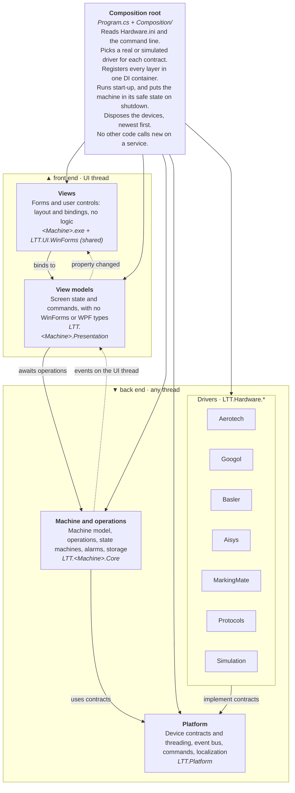
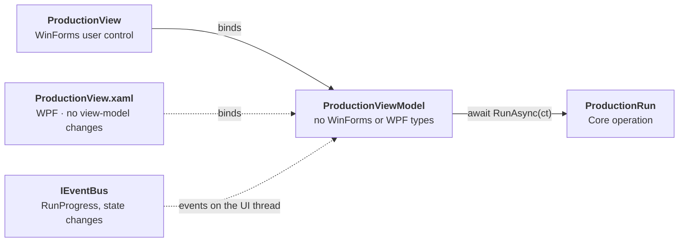
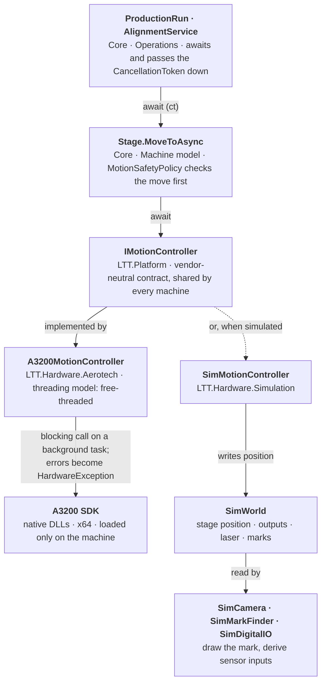
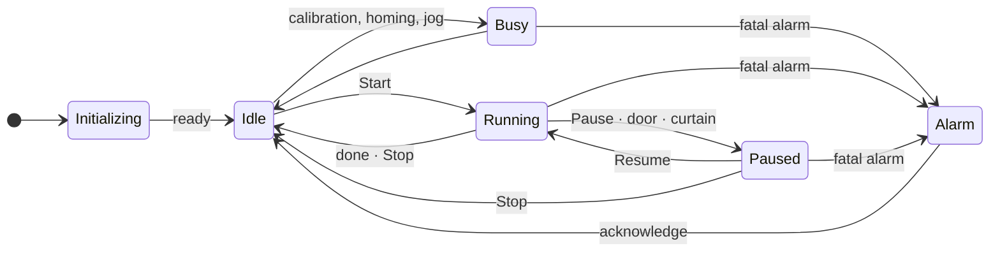
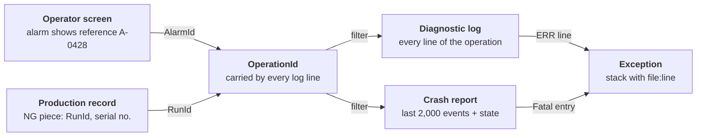

# LTT Machine Architecture

*Software architecture · LTT machine software · v3.6 · 28 Sep 2026*

The reference architecture for LTT machine control software. It defines four layers, what each one is responsible for, and the rules that keep every machine testable, maintainable and ready for WPF.

| Layers | UI pattern | Container | Thread rule | Stack |
|---|---|---|---|---|
| **4**<br>views · view models · core · platform and drivers | **MVVM**<br>the same view models serve WinForms and WPF | **MS.Extensions.DI**<br>runs on .NET Framework 4.7.2 and later | **UI never waits**<br>Core never marshals | **C# 12 · Serilog**<br>.NET Framework hosts, .NET Standard libraries |

> **Scope.** This document applies to every LTT machine application. How a particular machine adopts it, and the state of that machine's code today, belong in that machine's own documents. Names in angle brackets, such as `<Machine>`, stand for the machine's own name.

## Contents

1. [Overview](#part-1--overview)
   - [1.1 The layers](#11-the-layers)
   - [1.2 Responsibilities](#12-responsibilities)
   - [1.3 Assemblies and dependencies](#13-assemblies-and-dependencies)
2. [Layers](#part-2--layers)
   - [2.1 Views](#21-views)
   - [2.2 View models](#22-view-models)
   - [2.3 Core: machine and operations](#23-core-machine-and-operations)
   - [2.4 Platform](#24-platform)
   - [2.5 Drivers and simulation](#25-drivers-and-simulation)
   - [2.6 Composition root](#26-composition-root)
3. [Cross-cutting concerns](#part-3--cross-cutting-concerns)
   - [3.1 Threading](#31-threading)
   - [3.2 Events and machine state](#32-events-and-machine-state)
   - [3.3 Errors, alarms and safe state](#33-errors-alarms-and-safe-state)
   - [3.4 Data and configuration](#34-data-and-configuration)
   - [3.5 Logging and traceability](#35-logging-and-traceability)
   - [3.6 Exceptions, crashes and hangs](#36-exceptions-crashes-and-hangs)
4. [Quality](#part-4--quality)
   - [4.1 Testing](#41-testing)
   - [4.2 Guard rails](#42-guard-rails)
   - [4.3 Maintenance and versioning](#43-maintenance-and-versioning)
5. [Evolution](#part-5--evolution)
   - [5.1 Building a new machine](#51-building-a-new-machine)
   - [5.2 The WPF path](#52-the-wpf-path)
6. [History](#part-6--history)
   - [6.1 Revisions](#61-revisions)

---

## Part 1 — Overview

What the four layers are and how they depend on each other.

### 1.1 The layers

There are four layers, and dependencies point down only. The composition root is the only code that knows every layer, and it chooses which implementation goes behind each interface.



**Solid arrows are compile-time dependencies. Dashed arrows are runtime notifications.** The split between front end and back end also splits the threads: everything in the front end runs on the UI thread, and nothing in the back end touches the UI. Drivers depend on the Platform's contracts, never the reverse, and only the composition root references a driver. The view layer includes the shared UI toolkit, `LTT.UI.WinForms` (later `LTT.UI.Wpf`). Nothing named Platform references a UI framework. The Protocols box holds drivers LTT wrote itself over serial or TCP: the Lumentum laser, light controllers and height sensors.

### 1.2 Responsibilities

Each kind of class has one job. A class doing something from the "Never" column is in the wrong layer.

| Role | Layer | Does | Never |
|---|---|---|---|
| **View** | Views | Layout, bindings, focus; places vendor screens the operator must use | Logic, hardware calls, creating services |
| **View model** | View models | Screen state, commands, display text through `Loc` | Reference WinForms or WPF, block, marshal by hand |
| **Operation** | Core | One machine sequence: async and cancellable. Asks the operator through `IOperatorPrompt` | Touch controls, show dialogs, pick a thread |
| **Machine model** | Core | Named axes, signals and stations; the safety policy | Reference a vendor type |
| **State machine** | Core | Hold one lifecycle and reject invalid transitions | Call devices, do I/O, be written from two threads |
| **Contract** | Platform | A vendor-neutral interface for one kind of device | Contain vendor types or translated text |
| **Driver** | Drivers | Talk to one SDK or protocol. Own its threads. Throw `HardwareException` | Contain process rules, show dialogs, use `Loc` |
| **Simulator** | Drivers | Implement a contract against the shared `SimWorld` | Contain process rules |
| **Composition root** | Views (host) | Choose implementations, wire them, run start-up and shutdown | Anything else |

### 1.3 Assemblies and dependencies

| Assembly | Layer | May reference | Never references |
|---|---|---|---|
| `<Machine>.exe` | Views, composition root | Everything below, the driver assemblies, `LTT.UI.WinForms` | (top of the graph) |
| `LTT.UI.WinForms` | Views (shared UI toolkit) | Platform | Machine code, drivers, vendor SDKs |
| `LTT.<Machine>.Presentation` | View models | Core, Platform | WinForms, WPF, `System.Drawing`, drivers |
| `LTT.<Machine>.Core` | Machine and operations | Platform | Any UI, drivers, vendor SDKs |
| `LTT.Platform` | Contracts and kernel | The base library and small abstraction packages | Any UI, vendor SDKs, machine code |
| `LTT.Hardware.<Vendor>` | Drivers | Platform, the vendor SDK. An ActiveX driver also uses `System.Windows.Forms`, internally only, to host the control | Core, `LTT.UI.*`, other drivers |
| `LTT.Hardware.Simulation` | Drivers | Platform, `LTT.Hardware.Protocols` (for emulators) | Vendor SDKs, machine code |

A new assembly is added only for a new dependency boundary: a vendor SDK, a UI technology or a machine. Everything else is a folder. Inside an assembly, code is grouped by feature (`Alignment/`, `Calibration/`, `Production/`), not by kind (`Services/`, `Models/`), so a change to one feature stays in one place.

---

## Part 2 — Layers

Each layer's responsibilities, contents and rules, from the screen down to the hardware, and the composition root that wires them together.

### 2.1 Views

The view layer has two parts.

| Assembly | Holds |
|---|---|
| `<Machine>.exe` | The host application: forms and user controls for this machine, the composition root, and the WinForms implementations of the ports the lower layers need (dialog service, operator prompts, file dialogs, log panel). It places any vendor screen the operator must use, such as the AISYS VAlign teach screen. |
| `LTT.UI.WinForms` | The UI toolkit shared by every machine, which knows no machine:<br>• `LocUi` (fonts and texts per language).<br>• The `Bind(ICommand)` helper.<br>• `JogPad`, and device panels for I/O, camera parameters and lights. Each works against a device contract and takes its labels from the caller.<br>`LTT.UI.Wpf` will be its WPF counterpart. |

- A view binds to exactly one view model, in one block in its constructor, and contains no other logic.
- Pages are created by the container and added to the main window in code, so they can take constructor parameters. Each page's own designer still works.
- Anything a second machine could reuse unchanged goes into `LTT.UI.WinForms`, not into the machine's exe.
- Text comes from string-table keys, and fonts come from `LocUi.ApplyFontTree`. Views never set literal text or fonts.

`<Machine>.exe / Production / ProductionView.cs`

```csharp
internal partial class ProductionView : UserControl
{
    public ProductionView(ProductionViewModel vm)
    {
        InitializeComponent();
        lblBlock.DataBindings.Add("Text", vm, nameof(vm.BlockText));
        btnStart.Bind(vm.StartCommand);    // LTT.UI.WinForms: Click → Execute, Enabled ← CanExecute
        btnStop.Bind(vm.StopCommand);
    }
}
```

### 2.2 View models

Both MVP and MVVM separate screen logic from the controls. The difference is what survives a move to WPF:

| MVP (passive view) | MVVM (chosen) |
|---|---|
| The presenter calls `view.SetBlockText(…)` through an `IProductionView` interface. | The view model exposes properties and commands and raises `PropertyChanged`. It knows nothing about the view. |
| Every screen needs that interface, a presenter and a hand-written implementation in its code-behind. | WinForms on .NET Framework binds properties natively. Commands need one small helper. |
| WPF works against this style. Each WPF screen needs an adapter that turns the presenter's calls into bindable properties. | WPF binds the **same class** unchanged, so moving to WPF only means writing new views. |



**The view model is the unit that carries over from WinForms to WPF.** A WinForms view and a WPF view bind to the same class. It calls down into Core with `await` and receives events from the bus on the UI thread, so its properties change only on that thread.

`LTT.<Machine>.Presentation / Production / ProductionViewModel.cs`

```csharp
internal sealed class ProductionViewModel : ViewModelBase
{
    private readonly IProductionRun _run;
    private string _blockText = "";

    public ProductionViewModel(IProductionRun run, IMachineState state, IEventBus events)
    {
        _run = run;
        StartCommand = new AsyncCommand(ct => _run.RunAsync(ct), () => state.Mode == MachineMode.Idle);
        StopCommand  = new RelayCommand(_run.Stop, () => state.Mode == MachineMode.Running || state.Mode == MachineMode.Paused);
        events.Subscribe<RunProgress>(OnProgress);              // delivered on the UI thread
        events.Subscribe<MachineStateChanged>(_ => RaiseCanExecuteChanged());
    }

    public AsyncCommand StartCommand { get; }
    public RelayCommand StopCommand { get; }
    public string BlockText { get => _blockText; private set => Set(ref _blockText, value); }

    private void OnProgress(RunProgress e) => BlockText = Loc.Format("Run.Block", e.Index + 1, e.Total);
}
```

- **UI-neutral by construction.** `ICommand` and `INotifyPropertyChanged` are in the base library. `ViewModelBase`, `AsyncCommand` and `RelayCommand` come from `LTT.Platform`.
- **One place turns a click into an `await`.** `AsyncCommand` disables itself while it runs and logs any exception. Nothing else in the front end is `async void`.
- **Screen state only.** A view model holds what its screen shows and edits. Facts about the machine come from Core, through `MachineState`, read models and the bus.
- **Other windows** open through one generic `IDialogService.ShowAsync<TViewModel>()`, which looks up the view registered for that view model. There is no launcher with one method per window.
- **Small.** A view model with more than about eight dependencies is doing an operation's job, and the logic moves into Core. Guard rail G5 checks this.
- **Tested from the first commit,** against the simulators through the machine harness, with a scripted dialog service.

### 2.3 Core: machine and operations

Core holds everything the machine does, with no UI and no vendor code. It is headless: WinForms, WPF, the test harness, or a remote interface such as an MES link or a service tool all drive it the same way, through operations.

| Area | Holds | Examples |
|---|---|---|
| **Machine model** | Named axes, signals and stations over the device contracts, plus the safety policy | `Stage` (XY), Z and θ axes, `MachineIo` with named inputs and outputs, `VisionStation`, `MotionSafetyPolicy` |
| **Operations** | One class per machine sequence | Initialization, product load, alignment, production run, galvo-grid calibration, camera–laser offset, focus find, power calibration, manual motion |
| **State** | Lifecycles and alarms | `MachineState`, `ProductionRun`, `AlarmService` |
| **Storage** | Ports for the data Core owns, and their file implementations | `IProductRepository`, `ICalibrationStore`, `IProductionRecordSink`, `ISettingsStore` |
| **Host ports** | What Core needs from the application | `IOperatorPrompt`, `ILogger<T>`, `IEventBus`, `TimeProvider` |

#### Operations

- An operation is `async Task` and takes a `CancellationToken`. It runs through `MachineOperations`, which gives it exclusive use of the resources it names, sets the machine state and owns the cancellation.
- Operations use the machine model, and only the machine model uses device contracts. Shared steps, such as moving at the safety height or finding a mark, belong to the machine model and are never copied between operations.
- Operations report progress through events and ask the operator through `IOperatorPrompt`. They never show UI.
- Parameters come in as immutable snapshots. A run reads the product and settings once at its start and is not affected by edits made while it runs.

#### Motion safety policy

`MotionSafetyPolicy` holds the rules every move must pass: soft limits, Z at the safety height before long XY moves, interlocks closed, and the machine not in Alarm. The machine model does what the policy requires, such as lifting Z. It refuses anything else with a `HardwareException` that names the rule. Command `CanExecute` asks the same policy, so a button is disabled for the same reason the move would be refused.

#### Resources

`MachineOperations` hands out named resources: the stage, the laser, the camera, or a whole station. A single-station machine uses one resource for the whole machine. A machine with two tables or two heads declares one per station, and two operations can then run at once without a redesign.

### 2.4 Platform

`LTT.Platform` is shared by every machine. It holds the contracts devices are used through and the small kernel the other layers build on. It references no UI framework; the shared UI toolkit belongs to the [view layer](#21-views).

| Area | Contents |
|---|---|
| **Device contracts** | `IDevice`, `IMotionController` / `IAxis`, `IDigitalIO`, `ICamera`, `IMarkFinder`, `ILaserSource` / `ILaserPresets`, `IMarkingEngine`, `ILightController`, `IDistanceSensor` |
| **Capabilities** | Optional vendor features, discovered with `as`: `IAnalogInputs`, `ICommandScriptChannel` |
| **Device threading** | `DeviceGate`, `DeviceWorker`, and the UI-thread invoker for UI-bound devices, built on `SynchronizationContext` so it needs no UI framework (see Drivers) |
| **Errors** | `HardwareException`, `HardwareErrorCode` |
| **Kernel** | `IEventBus`, `ViewModelBase`, `AsyncCommand`, `RelayCommand`, `IDialogService`, `IOperatorPrompt`, the operation runner behind `MachineOperations` |
| **Localization** | `Loc`, string tables, `languages.tsv` |

#### Contract rules

- Contracts are vendor-neutral. They contain no vendor types and no translated text.
- Every long operation is async and takes a `CancellationToken`. Cancelling stops the hardware, then throws `OperationCanceledException`.
- Events are raised on driver threads. Consumers receive them through the bus.
- Status is an immutable snapshot (for example `AxisStatus`), replaced atomically so readers never see half an update.
- Vendor extras become capability interfaces, not members that every other driver has to stub.
- Changes are additive within a major version. Removing or changing a member means a new major version of the Platform (see [Maintenance](#43-maintenance-and-versioning)).

### 2.5 Drivers and simulation

Every device follows the same shape. Core calls a vendor-neutral contract. The driver behind it decides which thread calls the SDK, and turns SDK errors into one exception type. A simulator behind the same contract reads and writes one shared simulated machine.



**Real and simulated drivers sit behind the same contract, and only the driver chooses the thread.** The simulators share one `SimWorld`. A simulated stage move changes where the camera sees the mark, so alignment converges on a laptop and in tests.

#### Four threading models

Each driver states its threading model in its class remarks. The two models that need a mechanism have one in the Platform.

| Model | Mechanism | Use when | Examples |
|---|---|---|---|
| **UI-bound** | UI invoker | The operator must use the vendor's own screen, so its control is shown in the main window | AISYS VAlign when its teach screen and image display are used. Rule T8 applies |
| **Owner thread** | `DeviceWorker` | An SDK bound to the thread that created it: STA COM objects, ActiveX controls whose screens aren't needed (hosted on a hidden window), thread-affine native libraries | MarkingMate controls, COM motion channels such as ACS SPiiPlus, USB trim-engine libraries |
| **Serialised** | `DeviceGate` | Request/response protocols, and SDKs that aren't thread-safe but can be called from any thread | Lumentum laser, RS-232 light controllers, TCP height sensors, Googol GTS I/O |
| **Free-threaded** | none | A thread-safe SDK with its own callback thread | Aerotech A3200 (blocking moves on a background task, status from the diagnostics callback), Basler pylon |

Assign a model from the SDK manual's thread-safety statement, not from what happens to work.

#### ActiveX devices

MarkingMate and AISYS both ship their developer interface as ActiveX.

- **MarkingMate:** the OCX, with more than 1,000 functions, is Eastern Logic's integration route. The user manual lists no other API beyond I/O signals and an optional TCP/IP text input.
- **AISYS:** VAlign and the OVK Framework beneath it are both ActiveX components. VAlign is sold as a complete vision system with its own operator screens. Its only other interface is RS-232 commands, meant for PLC-controlled machines.

An ActiveX control needs three things: a single-threaded apartment (STA) thread, a message loop, and a parent window. It doesn't need to be visible, and it doesn't need the application's main UI thread. That leaves two ways to host one:

| Hosting | How | When |
|---|---|---|
| **Owner thread** (preferred) | A `DeviceWorker` in STA mode runs its own message loop and hosts the control on a hidden form. Every call goes through the worker. | The operator doesn't need the vendor's screen, as for MarkingMate marking. A preview of the marking file, if wanted, is drawn by our own view from the document. |
| **UI-bound** | The control sits in a panel in the main window, and calls are posted to the UI thread's `SynchronizationContext`. | The operator uses the vendor's screen, as with the VAlign teach screen. Rule T8 applies. |

- **Why owner thread is preferred.** The device no longer shares the UI thread, so a busy screen can't delay marking, and a long device call can't freeze the screen. The re-entrancy risk in rule T8 disappears for that device.
- **Check with the vendor first.** Before moving a control to an owner thread, confirm with the vendor that every control the driver uses works on a hidden window. Then run the device's contract tests on the machine. Several MarkingMate controls are already used while hidden. Whether the OVK processing modules work without a window is not publicly documented.
- **The UI-bound case can be avoided.** The OVK Framework also offers processing modules for pattern matching and alignment (OvkPat, OvkAlign), and AISYS lists .NET Framework and .NET 5/6 support. A driver built on those could find marks with no vendor screen, with teaching done in our own view. Because `IMarkFinder` is vendor-neutral, another vision library can also be swapped in without touching Core.
- **No UI toolkit in drivers.** Hosting an ActiveX control needs `System.Windows.Forms` inside the driver, for `AxHost`. The driver never references `LTT.UI.*`. It hands a vendor screen to the view layer through `IHasHardwareView`, and the view layer decides where to place it.

```csharp
// LTT.Platform: one call at a time. The timeout becomes HardwareException(Timeout, device).
public sealed class DeviceGate
{
    public DeviceGate(string device, TimeSpan timeout);
    public Task<T> RunAsync<T>(Func<CancellationToken, Task<T>> call, CancellationToken ct);
}

// LTT.Platform: every call runs on the thread that created the SDK object (STA pumps messages).
public sealed class DeviceWorker : IDisposable
{
    public DeviceWorker(string device, ApartmentState apartment);
    public Task<T> RunAsync<T>(Func<T> call, CancellationToken ct);
}
```

**Start, then wait.** Long operations (moves, homing, marking) begin with a short call and then await a completion event or status. They are never one long blocking call on a gate or worker, so Stop can always get through.

#### Driver rules

- One assembly per vendor SDK. It references the SDK and brings the SDK's native DLLs into the build output. A machine references only the drivers for the hardware it has.
- Drivers LTT writes over serial or TCP, with no vendor SDK, share `LTT.Hardware.Protocols`.
- Each driver comes with its own registration helper, for example `AddA3200Motion(axes)`.
- A driver converts every SDK error into a `HardwareException`, keeps vendor status codes to itself, and contains no process rules.
- Real drivers are created in `[MethodImpl(MethodImplOptions.NoInlining)]` factory methods, so simulation never loads a vendor assembly.
- `IDevice` has a `State` (Disconnected, Connecting, Ready or Faulted). Changes go on the bus as `DeviceStateChanged`, and the start-up screen and the status bar both show them.

#### Simulation

- Every contract has a simulator. Each device is Real or Simulated in `Hardware.ini`, and `--simulate` makes everything simulated, so the application runs on a laptop with no vendor SDKs installed.
- Protocol drivers run their real code against device emulators; the Lumentum emulator is one. Only the wire is simulated.
- `SimWorld` holds the simulated machine:
  - The stage position, written by the motion simulator.
  - The outputs, and the inputs derived from them (turning the vacuum on sets the vacuum sensor after a delay).
  - The laser state, which feeds the power-meter reading.
  - The mark positions of the loaded product.
  - Fault injection, such as a door opening at a set time.

  The machine supplies a `SimWorldProfile` that says which output feeds which input.
- Start-up refuses a real laser or marking engine combined with simulated motion or I/O. Simulation shows a banner in the title bar, and a Release build needs `--allow-simulation`.

### 2.6 Composition root

The container is **Microsoft.Extensions.DependencyInjection**. It targets .NET Standard 2.0, so it runs on .NET Framework, and it is the same container a WPF or .NET 8 host would use. Each assembly registers its own types through an `Add…()` extension method. Its classes can stay `internal`, but their constructors must be `public`.

`<Machine>.exe / Program.cs`

```csharp
[STAThread]
static void Main(string[] args)
{
    Application.EnableVisualStyles();
    Application.SetCompatibleTextRenderingDefault(false);
    SynchronizationContext.SetSynchronizationContext(new WindowsFormsSynchronizationContext());  // the event bus captures it

    var startup = HardwareStartup.Load(args);   // data root, Hardware.ini, --simulate

    var services = new ServiceCollection()
        .AddLttPlatform()                                     // event bus, operation runner, TimeProvider, logging
        .AddMachineHardware(startup.Profile)                  // real or simulated device per contract
        .AddMachineCore(startup.Paths)                        // machine model, operations, state, storage
        .AddMachinePresentation()                             // view models
        .AddMachineViews();                                   // main window, pages, dialogs, log panel

    using var provider = services.BuildServiceProvider(validateScopes: true);
    Application.Run(provider.GetRequiredService<MainShell>());
}   // safe state has run on close; leaving Main disposes the container, disconnecting devices newest first
```

`<Machine>.exe / Composition / HardwareModule.cs` (names illustrative)

```csharp
internal static class HardwareModule
{
    public static IServiceCollection AddMachineHardware(this IServiceCollection s, HardwareProfile hw)
    {
        if (hw.Motion == DeviceMode.Real) AddRealMotion(s, hw);
        else s.AddSimMotion(hw.Axes);                          // helper from LTT.Hardware.Simulation
        // I/O, camera, mark finder, marking engine, laser, peripherals: same pattern
        return s;
    }

    [MethodImpl(MethodImplOptions.NoInlining)]   // simulation never JIT-compiles a vendor type
    private static void AddRealMotion(IServiceCollection s, HardwareProfile hw) => s.AddA3200Motion(hw.Axes);
}
```

| Lifetime | Used for |
|---|---|
| Singleton | Devices, the machine model, operations, storage, the event bus, `MachineState`, `AlarmService`, the main window, pages and their view models. There is one machine, and pages live for the whole session. |
| Transient | Dialogs and their view models, created through `IDialogService`. |
| Scoped | Not used. |

- **One host at a time.** WPF pages are hosted inside the WinForms window, and later the other way round, so there is never a second DI graph to drift. If two hosts ever have to run in parallel, the `Add…()` calls move into a shared composition assembly first.
- **No service locator.** Only `Program.cs` and `IDialogService` resolve from the container. Everything else receives its dependencies through its constructor.
- **Start-up** is an ordered list of `IStartupStep`s: configuration, devices, calibration data, the marking engine. Each step reports to the start-up screen. Failures are collected and shown at the end, and only steps marked as required stop start-up.
- **Shutdown** cancels the running operation, puts the machine in its safe state, then disposes the container.
- **Unhandled exceptions** are logged and trigger the safe state. That covers `Application.ThreadException`, `AppDomain.UnhandledException` and `TaskScheduler.UnobservedTaskException`.

---

## Part 3 — Cross-cutting concerns

Concerns that run through every layer.

### 3.1 Threading

There are three kinds of thread, and each belongs to one layer. The UI thread belongs to views and view models. Core runs on pool threads and doesn't care which one. Device threads belong to their driver.

A vendor ActiveX control shown to the operator, such as AISYS VAlign, lives on the UI thread, and its driver marshals every call there. That makes blocking the UI thread dangerous as well as slow: a driver waiting to marshal onto a blocked UI thread deadlocks. Hosting ActiveX devices on their own owner thread wherever possible (see [Drivers](#25-drivers-and-simulation)) keeps this case rare.

```mermaid
sequenceDiagram
    participant UI as UI thread<br/>(never blocks · runs view models)
    participant Core as Core · thread pool<br/>(async throughout · never marshals)
    participant Dev as Device threads<br/>(owned by each driver)

    Note over UI: Operator clicks Start
    UI->>Core: await run.RunAsync(ct)
    Note over Core: Checks interlocks and laser
    Core->>Dev: await Stage.MoveToAsync(x, y, ct)
    Note over Dev: A3200 move, run by its driver
    Dev-->>Core: task completes
    Note over Core: Publishes RunProgress (block 2 of 4)
    Core-->>UI: bus posts to the UI thread
    Note over UI: BlockText set; the label repaints

    Note over UI,Dev: meanwhile
    Note over Dev: I/O poll thread: door opens
    Dev->>Core: InterlockChanged
    Note over Core: Run pauses at its next checkpoint
    Core-->>UI: MachineStateChanged(Paused)
    Note over UI: PAUSED banner; Resume enabled
```

**Nothing waits on the UI thread, and only the bus crosses onto it.** The interlock pauses the run without involving the UI thread, so pausing works even when the screen is busy. The UI finds out afterwards, from the state change.

#### Threading rules

- **T1. The UI thread never waits.** Views and view models don't use `.Wait()`, `.Result`, `Thread.Sleep`, `Application.DoEvents` or synchronous `Invoke`.
  *Analyzers enforce this at build time (G3).*
- **T2. View-model properties change on the UI thread only.** The bus delivers there, and code after an `await` in a view model resumes there.
  *So view models never use `ConfigureAwait(false)`. WinForms bindings throw if `PropertyChanged` fires on another thread.*
- **T3. Core and drivers use `ConfigureAwait(false)` and never marshal.** Every long operation is `async Task` and takes a `CancellationToken`. There is no `async void` below the view layer.
- **T4. One owner for cancellation.** `MachineOperations` runs operations and owns their cancellation. Stop cancels the current operation, and so does a fatal alarm.
  *Views and view models hold no `CancellationTokenSource` fields.*
- **T5. Drivers own their threads.** Each driver declares one of the four threading models and uses the matching Platform mechanism. Blocking SDK calls stay inside the driver.
  *Code above a driver never needs `Task.Run` to call it.*
- **T6. Continuous state is pulled. Discrete events are pushed.** Axis positions and I/O levels are snapshots that a UI timer reads 10–20 times a second. Alarms, interlocks, progress and state changes go on the bus.
  *This keeps high-rate data off the bus. For indicators, one merged update per poll is enough.*
- **T7. Operator prompts are async.** `IOperatorPrompt.AskYesNoAsync(…)` returns a `Task<bool>`. The host posts to the UI thread and shows a dialog owned by the main window, and Core awaits the answer.
- **T8. No device calls from code the UI thread runs while it pumps messages.** Paint, timer and device-event handlers read cached snapshots and never call a device.
  *A call into a UI-bound ActiveX control, or any STA COM call, pumps messages while it waits. A queued paint or timer can then run in the middle of it and call the same device again. That re-entrancy stalls or corrupts the device's state.*

### 3.2 Events and machine state

Components announce facts on a small typed event bus in `LTT.Platform`, instead of calling each other or wiring C# events across layers. The bus captures the UI `SynchronizationContext` when it is created. WPF installs one too, so the bus works there unchanged.

```csharp
public interface IEventBus
{
    void Publish<TEvent>(TEvent e);
    IDisposable Subscribe<TEvent>(Action<TEvent> handler, Delivery delivery = Delivery.UiThread);
}
public enum Delivery { UiThread, PublisherThread }   // UiThread uses Post, never Send
```

| Event (immutable, past tense) | Published by | Typical subscribers |
|---|---|---|
| `MachineStateChanged` | MachineState | Every page (command enablement), status bar, signal lights |
| `InterlockChanged` | Input monitor | MachineState (pause), I/O page |
| `AlarmRaised` · `AlarmCleared` | AlarmService | MachineOperations (cancel on fatal), alarm banner, alarm history |
| `DeviceStateChanged` | Each device | Start-up screen, status bar |
| `RunProgress` · `RunCompleted` | ProductionRun | Production page, records view |
| `LaserStateChanged` | Laser status monitor | Laser page, status bar |
| `ProductLoaded` | Product repository | Product, alignment and calibration pages |
| `OperatorChanged` | Access control | Main window (pages by role) |

#### Event rules

- **E1. One mechanism.** Core types don't expose C# events to other layers and don't implement `INotifyPropertyChanged`. Only view models do.
  *The one exception is `Loc.LanguageChanged`, which is part of the localization engine.*
- **E2. One marshal per update.** The bus posts once, and a view model sets its properties directly in the handler.
- **E3. Facts from their owner.** Only the owner of a fact publishes it. Events are past-tense facts, never requests and never UI gestures.
- **E4. No ordering between handlers.** If B must run after A, A's owner calls B directly, or B listens to an event that A publishes.
- **E5. No dead events.** A test lists event types with no subscriber. A handler that throws is logged, and the other handlers still run.

#### Machine state

`MachineState` in Core owns the machine's mode and the allowed transitions between modes. Each command's `CanExecute` reads the mode, and together with the safety policy that decides what the operator can do at any moment.



**Six modes, owned by one class.** Busy covers manual operations: calibration, homing, alignment and jog. Busy, Running and Paused all go to Alarm on a fatal alarm. Stop from Paused ends the run and returns to Idle. Invalid transitions are rejected and logged, so a button can't start something the machine isn't ready for.

#### The run has a state machine too

`ProductionRun` holds one run's lifecycle: Ready, Aligning, Marking (block *i* of *n*), Finishing, and then Completed, Cancelled or Failed. Pause is a gate the run awaits at its checkpoints. The class publishes `RunProgress` and `RunCompleted`. It is a plain class in Core with guarded transitions, one lock and one writer (the run operation), and it is unit-tested. It is the single place to ask whether a run is in progress. There are no separate "processing" or "marking" flags.

### 3.3 Errors, alarms and safe state

#### One error model

| Situation | Reported as |
|---|---|
| Device or protocol failure | `HardwareException(code, device)`. The driver converts every SDK error. The UI maps codes to string-table keys |
| Stop or cancel | `OperationCanceledException`. Logged as a cancellation, never as an error |
| An expected outcome that isn't a failure: mark not found, power out of tolerance, operator answered No | A result value (`MarkFindResult`, a power-check result) that the caller has to inspect |
| A condition the operator must see | An alarm, raised through `AlarmService` |
| Programming error | Any other exception. The operation ends, and `MachineOperations` logs it with its stack trace |

Status strings, `bool` success values and integer return codes don't go above the driver. A failed write of a settings file is logged and reported, but never stops a running process.

#### Alarms

Alarms are data, not message boxes. `AlarmService` in Core raises, clears and acknowledges them, and the alarm banner, alarm history, signal lights and log all read from it. Each alarm records:

- a code, which is also its string-table key (for example `Alarm.Motion.Fault`);
- its severity and source device;
- when it was raised and cleared;
- who acknowledged it.

Alarm history is stored alongside the production records.

| Severity | Effect | To clear |
|---|---|---|
| **Info** | Written to the operator log | Nothing |
| **Warning** | Banner. Operations continue | Clears itself when the cause goes away |
| **Error** | Banner. The current operation fails | Operator acknowledges. The alarm stays until then, even if the cause clears |
| **Fatal** | The machine goes to Alarm and into its safe state | Operator acknowledges, then the machine resets (homing if needed) |

#### Safe state

Each machine defines one `SafeState` routine in Core: stop motion, turn laser emission off and close the shutter, stop marking, and set outputs to their safe values. It runs on a fatal alarm, an emergency stop, an unhandled exception and shutdown. Each step is attempted on its own, so the routine still does what it can when a device has failed. A sequence test covers it.

### 3.4 Data and configuration

All data a machine reads and writes lives under one data root, separate from the program folder. It is stored in files, never in the registry, so copying the data root backs up or clones a machine. The program folder is replaced on every deployment and treated as read-only.

| Category | Examples | Changed by | Rule |
|---|---|---|---|
| **Factory defaults** | Default configuration, calibration patterns | A release | Read-only. Copied into the data root only when a file is missing |
| **Machine configuration** | Device addresses, Real/Simulated modes, axis mapping (`Hardware.ini`) | Commissioning | Validated at start-up. An invalid file stops start-up with a clear message |
| **Machine settings** | Speeds, offsets, soft limits, safety height | Engineers | Typed settings objects. Every change is audited |
| **Calibration** | Galvo correction table, camera–laser offset, vision templates | Calibration operations | The previous file is kept as a backup |
| **Products (recipes)** | Geometry, layers, marks, laser parameters | Engineers | A run takes an immutable snapshot when it starts |
| **Records and logs** | Production records, alarm history, logs | The machine | Append-only. Always in English |

- Each file has one owner class that reads and writes it, and nothing else touches the file. Paths come from one `MachinePaths` class, never from literals.
- Settings are typed, and validated when loaded. Each default is defined once, in code.
- Every file carries a schema version, and its owner migrates older versions when it loads them.
- Writes are atomic: write a temporary file, then replace the old one.
- Parameter changes are audited with who, when, the old value and the new value, so a changed result can be traced to a changed setting.

### 3.5 Logging and traceability

**Goal:** anything that happens on a machine can be traced back through the software. That covers an alarm the operator saw, an NG piece in the production records, or a crash. The trail leads to the operation that ran, the parameters it used, every device call it made and the line of code that failed. Nothing fails silently.



**One id links what the operator saw to the line of code that failed.** Alarms and production records store the OperationId (and RunId), and every log line carries them. Support starts from the reference on the screen or in the records, filters the logs by that id, and reaches the exception with its file and line number.

#### Log streams

| Stream | Audience | Language | Contents | Stored in |
|---|---|---|---|---|
| **Operator log** | Operators | UI language | Alarms, milestones, prompts and the answers given | Alarm history, beside the production records |
| **Diagnostic log** | Support, developers | English, structured | Everything, with the correlation ids below | `Logs\diagnostic-yyyyMMdd.log` and `.clef` |
| **Audit log** | Quality, supervisors | English | Logins, and every change to parameters, recipes, calibration results and bypass flags: who, when, old value, new value | `Logs\audit-yyyyMM.log`, append-only |
| **Device trace** | Developers | English | Raw device commands, replies and packets. Off by default | The diagnostic log, at Verbose |
| **Crash reports** | Support | English | Full exception, machine state, versions and recent events | `Logs\Crash\`, plus `Logs\Dumps\` for native crashes |

#### Correlation ids

These properties are attached through logging scopes and enrichers, so code never adds them to messages by hand.

| Property | Identifies | Set by |
|---|---|---|
| `SessionId` | One application start | Composition root |
| `OperationId` | One operation: a run, a calibration, homing, a manual move | `MachineOperations` |
| `RunId` | One production run | `ProductionRun` |
| `PieceId`, `SerialNumber` | One piece or array position within a run | `ProductionRun` |
| `AlarmId` | One alarm occurrence, shown to the operator as a short reference | `AlarmService` |
| `Device`, `Command` | A device call | The driver |
| `User`, `Role` | The logged-in person | Access control |
| `ThreadId`, `SourceContext`, `MachineName`, `AppVersion` | Every line | Enrichers |

Error dialogs and alarms show the operator a short reference, the AlarmId (for example `A-0428`). Production records carry RunId and OperationId, so an NG piece leads straight to its log lines.

#### Levels

| Level | Used for |
|---|---|
| **Verbose** | Device traffic. Off by default, switched on per driver from configuration |
| **Debug** | Step detail inside operations: positions, intermediate values, retries |
| **Information** | Operation start and end (with parameters, duration and result), state transitions, alarms raised and cleared, configuration and recipe loads, logins |
| **Warning** | Recoverable problems: a retried timeout, a mark not found on the first try, a failed settings write, a Warning alarm, a slow device call |
| **Error** | An operation failed. Always logged with the exception |
| **Fatal** | An unhandled exception. The safe state follows |

Production machines log at Information. An engineer can raise the level to Debug at run time from the engineering screen, with no restart, and it returns to Information on the next start. Even at Information, the last 2,000 events at every level are kept in memory for crash reports.

#### Logging rules

- **L1. Structured messages.** Log through `ILogger<T>` with message templates and named properties, such as `_log.LogInformation("Moved {Axis} to {Position} mm", axis, pos)`, never string interpolation.
  *The values stay searchable fields. Analyzer CA2254 makes a non-constant template a build error.*
- **L2. Every operation logs its start and end once, in one place.** `MachineOperations` logs the name, parameters and recipe checksum at start, and the result and duration at the end. Individual operations don't repeat this.
- **L3. Every state transition and alarm change is logged.** That covers machine mode, run state, and each alarm raise, clear and acknowledgement, with the ids and the user.
- **L4. Device failures carry their context.** The device, the command, the vendor error code and the `HardwareException` with the SDK exception as its inner exception. Successful device traffic is Verbose only.
- **L5. Log an exception once, where it is handled, with the exception object.** Use `_log.LogError(ex, …)`, never `ex.Message`. Layers in between don't log and rethrow.
  *One exception then produces one Error entry with its full stack, not five partial copies.*
- **L6. No silent catch.** Every `catch` does one of three things: rethrows; handles the problem and logs a Warning; or converts the exception to a `HardwareException` with the original as inner. A source-scan test finds empty catch blocks.
- **L7. Operator decisions are on record.** Every prompt and its answer is logged, for example "operator confirmed start with door open".
- **L8. Know exactly what ran.** Loading configuration, recipes or calibration logs the file, its schema version and a short SHA-256 checksum. The production record stores the recipe checksum too.
- **L9. No secrets.** Passwords never appear in any log, and personal data only as the login name.
- **L10. Logging never stops the machine.** Sinks are asynchronous, and a failing sink is reported but never blocks or throws into machine code.

#### Storage and retention

- **Two formats of the same events.** A text file (`diagnostic-yyyyMMdd.log`) is for reading. A compact JSON file (`.clef`) is for tools such as Seq, jq or a spreadsheet import. A new file starts each day, or when one reaches 200 MB.
- **Retention:**
  - diagnostic logs: 180 days;
  - crash reports and dumps: one year;
  - audit log, alarm history and production records: never deleted by the application.
- **Timestamps** are local time with milliseconds and the UTC offset. The machine clock is NTP-synchronised at commissioning, so logs from the machine, MES and other equipment line up.
- **Disk space** is checked at start-up and every hour. A Warning alarm is raised below a threshold, so logs never fill the data drive unnoticed.
- **Support package:** one command zips the recent logs, crash reports, audit log, alarm history, configuration and versions.

#### Serilog behind `ILogger<T>`

Core, Presentation, Platform and drivers reference only `Microsoft.Extensions.Logging.Abstractions`, and never Serilog. The host configures Serilog once, in the composition root.

| Package | Used for |
|---|---|
| `Serilog`, `Serilog.Extensions.Logging` | The logger, connected to `ILogger<T>` and the DI container |
| `Serilog.Sinks.File`, `Serilog.Sinks.Async` | Daily log files, written off the calling thread |
| `Serilog.Formatting.Compact` | The `.clef` JSON format |
| `Serilog.Exceptions` | Exception properties as searchable fields: `HardwareException` code and device, inner and aggregate exceptions |
| `Serilog.Enrichers.Thread`, `Serilog.Enrichers.Environment` | Thread id and machine name on every line |
| `Serilog.Sinks.Seq` *(optional)* | Live log search on a developer or support PC |

`<Machine>.exe / Composition / LoggingModule.cs`

```csharp
var level = new LoggingLevelSwitch(LogEventLevel.Information);    // raised to Debug from the engineering screen

Log.Logger = new LoggerConfiguration()
    .MinimumLevel.ControlledBy(level)
    .MinimumLevel.Override("LTT.Hardware", LogEventLevel.Warning)   // device trace off unless enabled
    .Enrich.FromLogContext()                                         // OperationId, RunId, Device, User from scopes
    .Enrich.WithThreadId()
    .Enrich.WithMachineName()
    .Enrich.WithExceptionDetails()
    .Enrich.WithProperty("SessionId", sessionId)
    .Enrich.WithProperty("AppVersion", appVersion)
    .WriteTo.Async(a => a.File(logs + "\\diagnostic-.log",
        rollingInterval: RollingInterval.Day, fileSizeLimitBytes: 200_000_000, rollOnFileSizeLimit: true,
        outputTemplate: "{Timestamp:yyyy-MM-dd HH:mm:ss.fff zzz} [{Level:u3}] (T{ThreadId}) {OperationId} {SourceContext}: {Message:lj}{NewLine}{Exception}"))
    .WriteTo.Async(a => a.File(new CompactJsonFormatter(), logs + "\\diagnostic-.clef",
        rollingInterval: RollingInterval.Day, fileSizeLimitBytes: 200_000_000, rollOnFileSizeLimit: true))
    .WriteTo.Sink(recentEvents, LogEventLevel.Verbose)               // ring buffer of the last 2,000 events, for crash reports
    .CreateLogger();

services.AddLogging(b => b.AddSerilog(dispose: true));   // flushes on shutdown
```

The ring buffer receives every level, so the `MinimumLevel` above applies to the files only. Deleting files past their retention period is a small start-up job, because `retainedFileCountLimit` counts files, not days.

`LTT.<Machine>.Core / Operations / MachineOperations.cs`: the one place operations start, end and fail

```csharp
using (_log.BeginScope(new Dictionary<string, object> { ["OperationId"] = op.Id, ["Operation"] = op.Name }))
{
    _log.LogInformation("{Operation} started {@Parameters}", op.Name, op.Parameters);
    var started = _time.GetTimestamp();
    try
    {
        await op.RunAsync(ct).ConfigureAwait(false);
        _log.LogInformation("{Operation} completed in {Elapsed}", op.Name, _time.GetElapsedTime(started));
    }
    catch (OperationCanceledException)
    {
        _log.LogInformation("{Operation} cancelled after {Elapsed}", op.Name, _time.GetElapsedTime(started));
        throw;
    }
    catch (Exception ex)
    {
        _log.LogError(ex, "{Operation} failed after {Elapsed}", op.Name, _time.GetElapsedTime(started));
        _alarms.Raise(AlarmCodes.OperationFailed, ex);                // the alarm keeps this OperationId
        throw;
    }
}
```

`Logs\diagnostic-20260928.log` (example)

```text
2026-09-28 14:03:12.418 +08:00 [INF] (T9)  7F3A LTT.<Machine>.Operations.MachineOperations: ProductionRun started {"Recipe":"PANEL-231","RecipeSha":"9c41e2d0"}
2026-09-28 14:03:15.902 +08:00 [ERR] (T14) 7F3A LTT.<Machine>.Operations.MachineOperations: ProductionRun failed after 00:00:03.484
LTT.Hardware.HardwareException: Following error on axis X (Device=MotionController, Code=DeviceFault, Vendor=A3200 0x1802)
   at LTT.Hardware.Aerotech.A3200MotionController.MoveLinearAsync(...) in A3200MotionController.cs:line 212
   at LTT.<Machine>.Machine.Stage.MoveToAsync(...) in Stage.cs:line 88
   at LTT.<Machine>.Production.ProductionRun.RunAsync(...) in ProductionRun.cs:line 141
2026-09-28 14:03:15.905 +08:00 [WRN] (T14) 7F3A LTT.<Machine>.State.AlarmService: Alarm A-0428 OperationFailed raised (Error)
```

### 3.6 Exceptions, crashes and hangs

Every failure, handled or not, has to leave a complete stack trace and enough context to explain it without reproducing it on the machine.

#### Keeping the stack trace

- **Ship the PDB files.** Release builds produce portable PDBs (`<DebugType>portable</DebugType>`) and deploy them next to every assembly. Stack traces then include file names and line numbers; .NET Framework reads portable PDBs for this from version 4.7.2.
- **Rethrow correctly.** Use `throw;` and never `throw ex;`, which discards the original stack. When wrapping, pass the original as `InnerException`. To rethrow on another thread, use `ExceptionDispatchInfo.Capture(ex).Throw()`.
- **Keep the vendor's detail.** Drivers turn SDK errors into a `HardwareException` carrying the device, command and vendor error code, with the SDK exception as inner, so the vendor's own message and stack survive.
- **Exceptions become fields.** `Serilog.Exceptions` writes exception properties, inner exceptions and `AggregateException` children as structured fields, which makes them searchable in the `.clef` log.

#### Unhandled exceptions

1. **Handlers are installed first,** in `Program.Main` before the container is built: `AppDomain.UnhandledException`, `Application.ThreadException` and `TaskScheduler.UnobservedTaskException`.
2. **Log Fatal** with the full exception.
3. **Write a crash report** to `Logs\Crash\crash-yyyyMMdd-HHmmss.txt`. It contains:
   - the exception with its full stack;
   - SessionId, and the current OperationId and RunId;
   - the machine and run state;
   - the application, driver and SDK versions, and the hardware profile;
   - the last 2,000 log events from the ring buffer, at every level.
4. **Run the safe state,** then flush the logs (`Log.CloseAndFlush()`).
5. **Tell the operator and close.** The operator sees a message with the crash report's reference. The application then closes, because an unhandled exception leaves it in an unknown state. The next start-up screen shows the previous crash's reference.

#### Native crashes and hangs

- **Crash dumps for vendor DLLs.** A crash inside native vendor code (an access violation) can end the process before any .NET handler runs. Commissioning therefore turns on Windows Error Reporting local dumps for the application: `HKLM\SOFTWARE\Microsoft\Windows\Windows Error Reporting\LocalDumps\<Machine>.exe`, with `DumpFolder` set to `<data root>\Logs\Dumps`, `DumpType=2` (full) and `DumpCount=5`. A dump opens in Visual Studio or WinDbg together with the PDBs.
- **UI watchdog.** A background timer posts a heartbeat to the UI thread every second. If a heartbeat waits more than 5 s, the watchdog logs a Warning naming the current operation and the last device call. After 30 s it writes a process dump (`MiniDumpWriteDump`) to `Logs\Dumps`, which shows where every thread is stuck.
- **Slow device calls.** `DeviceGate` and `DeviceWorker` log a Warning when a call takes longer than its expected time, naming the device and the command. A stuck SDK call becomes visible before it turns into a hang.

#### Verifying traceability

- A sequence test with a recording logger checks that every operation logs its start and end with its OperationId.
- A fault-injection test makes a simulated driver throw. It then checks for exactly one Error line with the exception and stack, an alarm with the same OperationId, and an NG record with the RunId.
- A test raises an unhandled exception and checks that the crash report is written and the safe state runs.
- Guard rails: CA2254 is a build error, and a source scan fails on empty `catch` blocks and on `throw ex;`.

---

## Part 4 — Quality

How the architecture stays correct as it changes: tests, automated checks and maintenance rules.

### 4.1 Testing

The layers are designed so that almost everything can be tested without a machine. There are three kinds of test.

| Kind | Covers | Runs |
|---|---|---|
| **Unit** | One class in isolation: state machines, policies, calculations, view models, and driver protocol encoding against a device emulator | Every build |
| **Device contract** | One shared suite per device contract. It runs against the simulator and against the real driver | Simulator: every build. Real driver: on the machine |
| **Sequence** | Whole operations on the simulators through the machine harness. For production-path changes, the run's production record must match the previous build's | Every build |

Architecture checks (dependencies, threading analyzers, ratchets) are covered in [4.2 Guard rails](#42-guard-rails). On the machine, the device contract tests run first, followed by the commissioning checklist.

#### Device contract tests keep simulators honest

One abstract test class per contract states what every implementation must do. The simulator's subclass runs on every build. The real driver's subclass runs on the machine. A simulator that drifts away from the real device then fails a test, instead of letting a sequence test pass for the wrong reason.

```csharp
public abstract class MotionControllerContract
{
    protected abstract IMotionController Create();

    [TestMethod] public async Task Move_completes_in_position() { … }
    [TestMethod] public async Task Cancel_aborts_the_move_and_throws() { … }
    [TestMethod] public async Task Move_beyond_soft_limit_is_rejected() { … }
}

[TestClass] public class SimMotionControllerTests : MotionControllerContract { … }
[TestClass, TestCategory("Hardware")] public class A3200MotionControllerTests : MotionControllerContract { … }
```

#### Virtual time

Delays, timeouts, polling intervals and simulated motion all read time from `TimeProvider`. On .NET Framework this comes from the `Microsoft.Bcl.TimeProvider` package; .NET 8 has it built in. Tests use `FakeTimeProvider` to advance time explicitly. A full production run then takes seconds in a test and runs the same way every time. Nothing below the view layer calls `Thread.Sleep` or `DateTime.Now` directly.

#### The machine harness

One test helper builds the real Core services over the simulators. It uses a temporary data root, a recording logger and a scripted operator prompt, and it wires them with the same `Add…()` helpers as the composition root. Sequence tests and view-model tests share it.

### 4.2 Guard rails

A rule holds only while breaking it fails the build. These checks keep the architecture from decaying.

- **G1. Tests, not scripts.** Every check is an MSTest test or an analyzer that runs in the normal build.
- **G2. No vacuous passes.** Every source scan asserts that it found files. A scan of zero files fails.
- **G3. Threading analyzers.** `Microsoft.VisualStudio.Threading.Analyzers` catches `async void`, synchronous waits and forgotten tasks. CA2007 requires `ConfigureAwait(false)` in Core, Platform and drivers. Both are build errors.
- **G4. Boundary tests.** The dependency table in [1.3 Assemblies and dependencies](#13-assemblies-and-dependencies) is checked on the compiled assemblies. Drivers must not call `Loc`.
- **G5. Ratchets only go down.** Legacy patterns in views and view models (`async void`, `Task.Run`, `.Enabled =`, `MessageBox.Show`, `Invoke(`) are counted, along with files that don't yet have nullable reference types enabled. Each view model has a ceiling on constructor parameters. The pull request that removes code lowers the baseline. Raising one needs a stated reason in review.
- **G6. The container builds.** One test builds the container in simulation mode and resolves the main window and every page.
- **G7. The production record is compared on production-path changes.** See sequence tests in [4.1 Testing](#41-testing).
- **G8. Logging checks.** CA2254 (constant message templates) is a build error. A source scan fails on empty `catch` blocks and on `throw ex;`. See 3.5 and 3.6.
- **G9. Numbers live in tests, not documents.** Documents describe rules and decisions. Counts that change go in the ratchet tests.

Every push builds the solution and runs every test except the `Hardware` category, all in simulation.

### 4.3 Maintenance and versioning

- **Packages.** Once a second machine uses them, the Platform and drivers move to their own repository and become versioned packages on an internal NuGet feed. Each machine pins the versions it uses. Contract changes are additive within a major version.
- **Project files.** All projects are SDK-style. `Directory.Build.props` holds shared properties. Central Package Management (`Directory.Packages.props`) keeps every assembly on the same package versions.
- **Runtime.** Hosts and drivers stay on .NET Framework (4.7.2 or later) as long as the vendor SDKs require it. The UI-free assemblies (Platform, Core, Presentation) target .NET Standard 2.0, so they can move to .NET 8 without changes when the SDKs allow.
- **Language.** `Directory.Build.props` sets `LangVersion` to `12` and `Nullable` to `enable` for every assembly. [PolySharp](https://github.com/Sergio0694/PolySharp), a source generator, adds the attributes .NET Framework lacks for records, `init`, `required`, index and range, and the nullable annotations.
  - **Use freely:** records, `init`, `required` members, switch expressions and patterns, file-scoped namespaces, global usings, primary constructors, collection expressions.
  - **Not available on .NET Framework** (they need runtime support): default interface members, static abstract interface members, covariant return types.
  - **Nullable warnings** are errors in the Platform and in new assemblies. Existing code turns them on file by file (`#nullable enable`) as it is touched, and a ratchet (G5) counts the files still without it.
  - **Raising the pin** to C# 13 or 14 is a one-line change, made once every developer and the build server are on a toolchain that supports it.
- **Decision records.** Each architectural decision gets a short ADR in the repository (`docs/adr/NNNN-title.md`) with its reasoning and alternatives. This document states the outcomes.
- **A README per assembly** covers its purpose, what it may reference and how to test it.
- **Change discipline.** Every commit builds, passes all tests and starts in simulation. Behaviour changes go in their own commits and are listed for machine verification. Refactoring commits don't change behaviour.

---

## Part 5 — Evolution

Using the architecture for a new machine, and moving the front end to WPF.

### 5.1 Building a new machine

| Reused as-is | Written for the machine |
|---|---|
| `LTT.Platform`: contracts, device threading, bus, commands, localization | `LTT.<Machine>.Core`: machine model, safety policy, safe state, operations, storage |
| `LTT.UI.WinForms`: `LocUi`, `JogPad`, binding helpers, device panels | `LTT.<Machine>.Presentation`: view models |
| The drivers for the hardware it shares, including `Protocols` | `<Machine>.exe`: views and composition root |
| `LTT.Hardware.Simulation` and `SimWorld`, so the machine runs on a laptop from day one | `LTT.<Machine>.Tests` and a `SimWorldProfile` |

1. **Start from the template** — *the four machine assemblies, `Program.cs`, the data-root layout*
   Everything builds and starts in simulation before any machine code is written.
2. **Describe the hardware** — *`Hardware.ini`, driver references*
   Missing hardware gets a new `LTT.Hardware.<Vendor>` driver that implements an existing contract, a simulator, and the contract tests. Add a new contract only for a new kind of device.
3. **Model the machine** — *axes, signals, stations, safety policy, safe state*
   Also the `SimWorldProfile`, so the simulation behaves like this machine.
4. **Write the operations** — *with sequence tests in simulation*
   Each sequence runs end to end on a laptop before it runs on the machine.
5. **Write the view models, then the views** — *view-model tests first*
   The views stay thin enough to review at a glance.
6. **Commission** — *on the machine*
   Run the `Hardware` contract tests, then the commissioning checklist.

### 5.2 The WPF path

Nothing below the view layer changes when WPF arrives. The migration goes page by page, and the application can ship after every step.

1. **Every page has a view model** — *prerequisite*
   WinForms views bind to them. Everything after this depends on it.
2. **Add LTT.UI.Wpf** — *one assembly*
   WPF versions of `JogPad` and the device panels, and a font helper that matches `LocUi` (the font family per language comes from `languages.tsv`). The event bus and commands already work in WPF.
3. **Host WPF pages inside the WinForms window** — *ElementHost, one page at a time*
   Each migrated page gets a XAML view over the same view model. Operators see one application throughout.
4. **Switch the main window to WPF** — *WindowsFormsHost for the rest*
   Pages not yet migrated, and any vendor screen the operator uses, are hosted in `WindowsFormsHost`. Controls on owner threads are unaffected, because they are never shown.
5. **.NET 8 (separate decision)** — *optional*
   The UI-free assemblies are already .NET Standard 2.0. Check each vendor SDK on .NET 8 x64 first; native SDKs and ActiveX controls are the risks.

> **Known WPF limit:** WinForms content hosted in WPF always draws on top ("airspace"). Give vendor screens such as AISYS VAlign their own regions, with no WPF popups or overlays above them.

---

## Part 6 — History

How this document has changed.

### 6.1 Revisions

| Version | Date | Changes |
|---|---|---|
| v1 | 24 Sep 2026 | First draft: four layers, MVVM front end, DI, threading rules, event bus and machine state, the WPF path. |
| v2 | 25 Sep 2026 | After a review of an existing machine codebase: device threading models, `DeviceGate` and `DeviceWorker`, one error model, the motion safety policy, `SimWorld`, the run state machine, event rules, rule T8, guard rails. |
| v2.1 | 25 Sep 2026 | Decisions D1–D4 agreed. |
| v3 | 25 Sep 2026 | Made independent of any one machine: content about a specific machine and its current code moved to that machine's own documents. Restructured by layer. Added:<br>• the assembly dependency table;<br>• errors, alarms and safe state;<br>• data and configuration;<br>• logging and diagnostics;<br>• a testing strategy with contract tests and virtual time;<br>• maintenance and versioning;<br>• threading analyzers;<br>• resources for multi-station machines;<br>• decisions D5–D10 and open questions O1–O2. |
| v3.1 | 25 Sep 2026 | O1 and O2 settled. D11: C# 12, pinned, with nullable reference types and PolySharp (moving to a newer version agreed). D12: Serilog behind `ILogger<T>`, with its packages and configuration. Code samples updated to C# 12. |
| v3.2 | 25 Sep 2026 | The shared UI assemblies are renamed `LTT.UI.WinForms` / `LTT.UI.Wpf` and belong to the view layer (D13). The Platform references no UI framework, and its UI-thread invoker is built on `SynchronizationContext`. Added ActiveX hosting guidance from vendor research: owner thread with a hidden window is preferred, UI-bound only for vendor screens (D14). Drivers no longer reference any UI assembly. |
| v3.3 | 25 Sep 2026 | Reorganised into six parts (Overview, Layers, Cross-cutting concerns, Quality, Evolution, Decisions and history) with numbered sub-sections and a contents block. No change to the content. |
| v3.4 | 25 Sep 2026 | `LTT.UI.WinForms` moved next to the exe in the dependency table, since it belongs to the view layer. The Trade-offs and Decisions sections were removed; decisions are kept as ADRs in the repository. Testing reduced to three kinds: unit, device contract, sequence. |
| v3.5 | 28 Sep 2026 | Logging specification for full traceability. 3.5 is renamed "Logging and traceability" and adds: log streams including an audit log; correlation ids; the level policy; logging rules L1–L10; storage and retention; an updated Serilog set-up; operation logging code and an example log. New 3.6 "Exceptions, crashes and hangs" covers PDB deployment, rethrow rules, crash reports with a ring buffer, native crash dumps, the UI watchdog and traceability tests. A logging guard rail was added. |
| v3.6 | 28 Sep 2026 | Diagnostic log retention raised to 180 days, and log files now roll over at 200 MB. |

---

*Code samples use C# 12 (D11), and their names are illustrative.*
